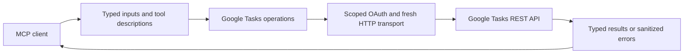

# Design review and implementation choices

Reviewed source on 2026-10-26. This is a focused comparison, not an audit or a claim to rank every Google Tasks MCP server. Source inspection does not establish that a reference project's deployed behavior works.

| Reference | Useful pattern | Choice in this implementation |
| --- | --- | --- |
| [Oskar: API client](https://github.com/oskarengl/google-tasks-mcp/blob/main/src/gtasks.ts) and [write tools](https://github.com/oskarengl/google-tasks-mcp/blob/main/src/tools/write.ts) | Calendar dates, PATCH, completed/hidden flags, native move | Adopt those API semantics; expose page tokens and bounded scans. Avoid title-based recurrence heuristics and ambiguous first-title matches. |
| [Scottie: server](https://github.com/scottie-will/google-tasks-mcp/blob/main/src/server.ts) and [create tool](https://github.com/scottie-will/google-tasks-mcp/blob/main/src/tools/create-task.ts) | Readable tool definitions and server instructions | Keep descriptions explicit and modules small; add pagination instead of limiting list reads to one unmarked page. |
| [Girmmy: API service](https://github.com/girmmy/google-tasks-mcp-server/blob/main/src/services/tasksClient.ts) | Actionable auth errors and detecting replaced tokens | Load current authorization for each tool operation; no cached process-wide HTTP client or stale token. |
| [Ebmurha: server](https://github.com/ebmurha/google-tasks-mcp/blob/main/src/google_tasks_mcp/server.py) and [resolver](https://github.com/ebmurha/google-tasks-mcp/blob/main/src/google_tasks_mcp/resolver.py) | Search, task digests, and explicit incomplete-result handling | Add bounded personal workflows and exact-ID mutation inputs. Use Google's native cross-list move rather than copy/delete emulation. Omit hosting and multi-account infrastructure. |

The main improvements are relative to the project's original tutorial implementation, not claims that every reference lacks these capabilities.

## Request flow

1. The official MCP SDK validates input types and publishes output schemas.
2. Explicit validators reject blank IDs/titles, impossible dates, and conflicting updates before network calls.
3. OAuth is read-only until the user grants the write scope. A separate process option hides write tools entirely.
4. Each operation uses a fresh client scope; internal scan requests reuse only that operation's transport. Token refresh is serialized within a process and token replacement is atomic across readers.
5. Reads can retry transient errors. Mutations have no application-level retry because a failed response does not prove a failed write. Caller retries can still create duplicates.
6. Errors returned to clients are actionable and do not include raw request URLs, credentials, or Google response bodies.

## Deliberate tradeoffs

Live read verification caught an upper-date boundary that the first fake-service
tests missed: using the selected date at 23:59:59 for Google's `dueMax` omitted a
known task on that date. Using the following day at midnight included it. The
client now requests that wider upper bound and enforces the promised inclusive
calendar-date range locally. A regression fixture reproduces the observed API
behavior; the live smoke check requires the known dated task to be present.

- **No mutation by name.** Convenience is less useful than ensuring duplicate names cannot target the wrong resource.
- **No automatic all-account unbounded scan.** Search/digest report their budgets and incomplete results.
- **No inferred recurrence.** Duplicate titles are not a reliable recurrence signal.
- **No fake delete semantics.** Google's clear endpoint hides completed tasks; output calls this hiding.
- **No cross-list copy/delete fallback.** A failed native move is reported rather than replaced with a non-atomic two-step operation.
- **No hidden sign-in.** Only the authentication command opens a browser; MCP tools return an instruction to run it.
- **No claim that a confirmation flag is a human approval.** The host owns approval UI. Exact titles and nonempty-list checks reduce accidental targeting but are not a transactional lock.
- **Single user, local process.** The token lock is within a process; atomic replacement prevents partial JSON. Multiple independent processes can still refresh concurrently. Use one active server per account for predictable operation.

## Official references

- [Google Task fields and limitations](https://developers.google.com/workspace/tasks/reference/rest/v1/tasks)
- [Listing and hidden/completed flags](https://developers.google.com/workspace/tasks/reference/rest/v1/tasks/list)
- [PATCH](https://developers.google.com/workspace/tasks/reference/rest/v1/tasks/patch)
- [Native move](https://developers.google.com/workspace/tasks/reference/rest/v1/tasks/move)
- [OAuth authorization](https://developers.google.com/identity/protocols/oauth2)
- [Official Python MCP SDK](https://py.sdk.modelcontextprotocol.io/)
